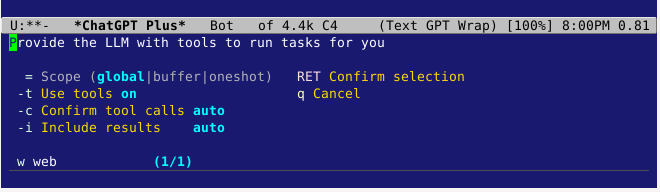
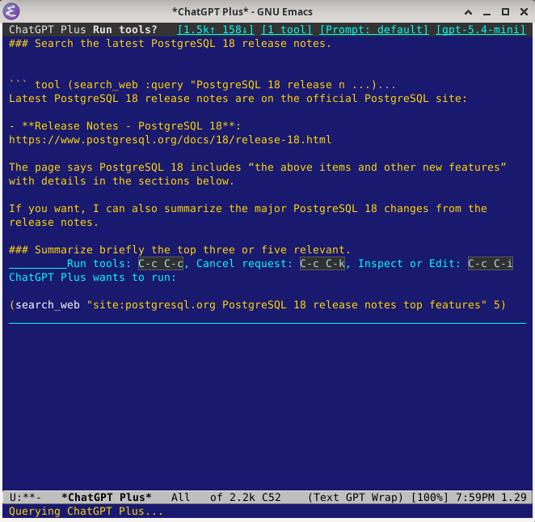

## GPTEL WEB

**Package:** `src/e/gptel-web/`

**Name:** GPTEL WEB

**Author:** Victor C

### Brief

Web search tools for gptel.

### Goals

- Provide a simple alternative to MCP-based `web_search`.
- Use `ddgr` (GPLv3) to search the Internet.
- Keep the setup simple, lightweight, reliable, and easy to debug.

## Prerequisites

- GNU Emacs with package support enabled.
- Internet connection.
- `ddgr` installed.
- `gptel` installed from MELPA (recommended latest version).

## Install ddgr (example: Devuan/Debian)

```sh
sudo apt-get update
sudo apt-get install ddgr
```

Verify the installation:

```sh
ddgr --np --num 3 PostgreSQL
```

## Configure MELPA

Add the following near the beginning of your `init.el` (or `.emacs`) if
MELPA is not already configured:

```elisp
(require 'package)

(add-to-list 'package-archives
             '("melpa" . "https://melpa.org/packages/")
             t)

(package-initialize)
```

Restart Emacs or evaluate the configuration.

## Install gptel

```text
M-x package-refresh-contents
M-x package-install RET gptel RET
```

## Configure gptel

Add the following to your `init.el` (or `.emacs`):

```elisp
(use-package gptel
  :ensure t
  :config
  ;; ChatGPT Plus backend
  (setq gptel-backend
        (gptel-make-openai-oauth "ChatGPT Plus"))
  ;; Default model
  (setq gptel-model 'gpt-5.4-mini)
  ;; Major mode for saved chats
  (define-derived-mode gptel-chat-mode text-mode "GPTEL-Chat"
    "Major mode for saved gptel conversations."
    (gptel-mode 1))
  ;; Associate .chat files
  (add-to-list 'auto-mode-alist
               '("\\.chat\\'" . gptel-chat-mode)))
```

Restart Emacs or evaluate the configuration.

## (Optional) Authenticate with ChatGPT

You can authenticate explicitly:

```text
M-x gptel-openai-oauth-login
```

Otherwise, gptel will prompt you to log in the first time it needs to
access your ChatGPT account.

## Install GPTEL WEB

Extract the package, for example to:

```text
~/src/e/gptel-web/
```

Then add the following near the end of your `init.el` (or `.emacs`):

```elisp
(load "~/src/e/gptel-web/gptel-web.el")
```

Restart Emacs or evaluate the configuration.

## Verify installation

Display the list of registered tools:

```text
M-x gptel-tools
```

You should see the `web` category containing the `search_web` tool.



## Test

Open a gptel chat and ask a question that requires current information,
for example:

> Search the latest PostgreSQL 18 release notes.



If tool confirmation is enabled, gptel will ask for confirmation before
running the local `ddgr` command.


