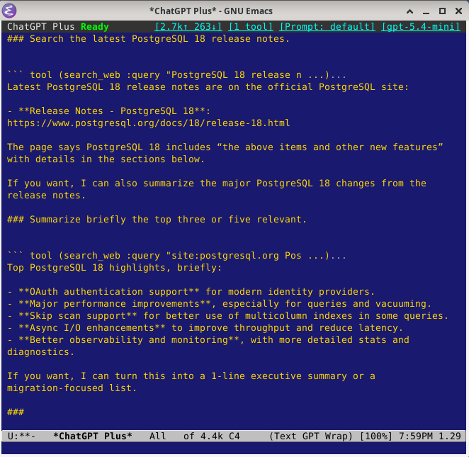
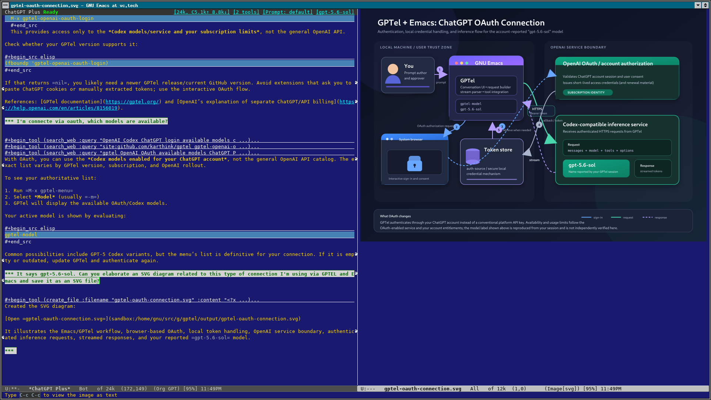

## GPTEL WEB

**Package:** `src/e/gptel-web/`

**Name:** GPTEL WEB

**Author:** Victor C

### Brief

Web search & file tools for gptel.

### Goals

- Provide a simple alternative to MCP-based `search_web`.
- Use DuckDuckGo through the local `ddgr` (GPLv3) command to search the
  Internet.
- Keep the setup simple, lightweight, reliable, and easy to debug.
- Restricted file creation tool for gptel. Saves generated UTF-8 files
  to a designated output directory.

## Prerequisites

- GNU Emacs with package support enabled.
- Internet connection.
- `ddgr` installed.
- `gptel` installed from MELPA (recommended latest version).

## Install ddgr (example: Devuan/Debian)

```sh
sudo apt-get update
sudo apt-get install ddgr
```

Verify the installation:

```sh
ddgr --np --num 3 PostgreSQL
```

## Configure MELPA

Add the following near the beginning of your `init.el` (or `.emacs`) if
MELPA is not already configured:

```elisp
(require 'package)

(add-to-list 'package-archives
             '("melpa" . "https://melpa.org/packages/")
             t)

(package-initialize)
```

Restart Emacs or evaluate the configuration.

## Install gptel

```text
M-x package-refresh-contents
M-x package-install RET gptel RET
```

## Configure gptel

Add the following to your `init.el` (or `.emacs`). You can set
`vc/gptel-root-path` here. `~/src/g/gptel` is the default:

```elisp
;; GPTEL
(use-package gptel
  :ensure t
  :config
  ;; ChatGPT Plus backend
  (setq gptel-backend
        (gptel-make-openai-oauth "ChatGPT Plus"))
  ;; Default model
  (setq gptel-model 'gpt-5.6-sol)
  ;; Use Org-mode for new GPTEL conversations
  (setq gptel-default-mode 'org-mode)
  ;; Saved Org chats under vc/gptel-root-path (~/src/g/gptel default)
  (setq vc/gptel-root-path "~/src/g/gptel")
  (defun vc/gptel-org-setup ()
    "Enable gptel-mode for Org files in the GPTEL chats directory"
    (when (and buffer-file-name
               (file-in-directory-p
                buffer-file-name
                (expand-file-name vc/gptel-root-path)))
      (gptel-mode 1)))
  (add-hook 'org-mode-hook #'vc/gptel-org-setup)
  ;; Legacy .chat compatibility
  (define-derived-mode gptel-chat-mode text-mode "GPTEL-Chat"
    "Major mode for legacy gptel conversations"
    (gptel-mode 1))
  (add-to-list 'auto-mode-alist
               '("\\.chat\\'" . gptel-chat-mode)))
```

Restart Emacs or evaluate the configuration.

## (Optional) Authenticate with ChatGPT

You can authenticate explicitly:

```text
M-x gptel-openai-oauth-login
```

Otherwise, gptel will prompt you to log in the first time it needs to
access your ChatGPT account.

## Install GPTEL WEB

Extract the package, for example to:

```text
~/src/e/gptel-web/
```

Then add the following near the end of your `init.el` (or `.emacs`):

```elisp
(load "~/src/e/gptel-web/gptel-web.el")
```

Optionally, you can add the following module that saves files in the
folder `output/` inside the path `vc/gptel-root-path` defined in the
Elisp code above. It isn't mandatory. If, for security reasons, you
don't want to allow the agent to write files in a contained output
directory, you don't need to include it. Add the following near the end
of your `init.el` (or `.emacs`):

```elisp
(load "~/src/e/gptel-web/gptel-file.el")
```

Restart Emacs or evaluate the configuration.

**Note:** Verify if `vc/gptel-root-path` & `vc/gptel-root-path/output/`
  are created. For this example, we set `vc/gptel-root-path` to
  `~/src/g/gptel`.

## Verify installation

Display the list of registered tools:

```text
M-x gptel-tools
```

You should see the `web` category containing the `search_web`
tool. Optionally, if you enabled gptel-file, you'll see the `filesystem`
category containing the `create_file` tool as well.


## Testing search_web

Open a gptel chat and ask a question that requires current information,
for example:

> Search the latest PostgreSQL 18 release notes.


If tool confirmation is enabled, gptel will ask for confirmation before
running the local `ddgr` command.



## Testing search_web and create_file

After you ask to look for something on the internet or create and save a
file, press `C-c RET` to submit your request. Before any action, it will
ask for approval: press `C-c C-c` to approve, then enjoy.


